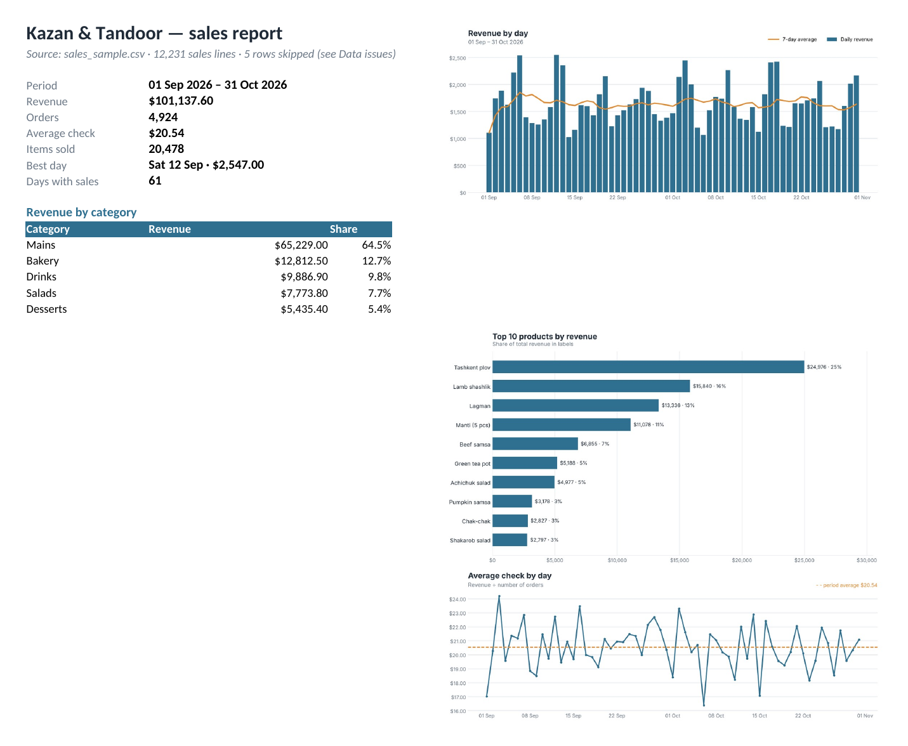
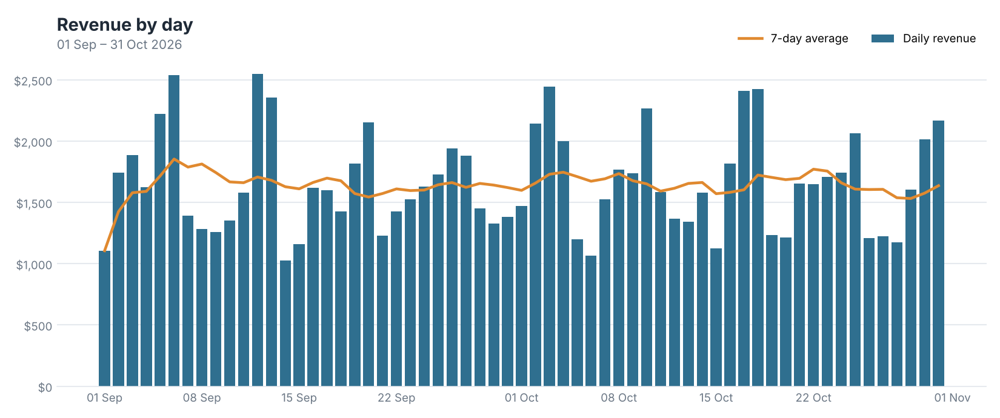
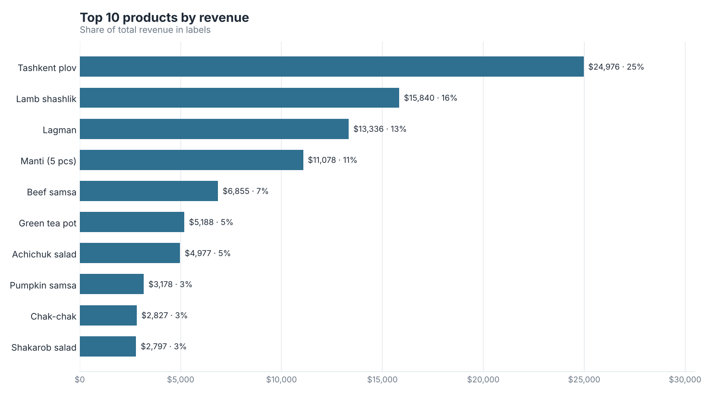

# Sales Report Automation (Python)

> **Concept project.** The example data is generated for a fictional cafe (Kazan & Tandoor). No real business data is included.

One command turns a raw sales export from a POS, online store or accounting system (CSV or Excel) into a ready-to-share report:

- an **Excel workbook** with a summary page, daily table with a native Excel chart, top products, a list of skipped rows and the cleaned data
- three **PNG charts**: revenue by day with a 7-day average, top products, and average check by day

```bash
python -m sales_report examples/sales_sample.csv --title "Kazan & Tandoor — sales report"
```

```
Kazan & Tandoor — sales report: 01 Sep 2026 – 31 Oct 2026
  Revenue         $101,137.60
  Orders          4,924
  Average check   $20.54
  Items sold      20,478
  Best day        Sat 12 Sep · $2,547.00
  Days with sales 61
  Skipped rows    5 (listed on the 'Data issues' sheet)
```



| Revenue by day | Top products |
| --- | --- |
|  |  |

The full example output is in [`docs/example_output/`](docs/example_output/).

## What it handles

- **Different exports, no manual renaming.** Columns are matched by common names, e.g. `Order Date` / `date`, `Receipt ID` / `order_id`, `Item` / `product`, `Qty`, `Price`, `Total`. Russian headers (`Дата`, `Номер чека`, `Товар`, `Количество`, `Цена`, `Сумма`) work too.
- **Revenue or price × quantity.** If there is no total column, revenue is calculated from quantity and unit price.
- **Messy numbers and dates.** Currency signs, thousands separators, decimal commas (`9,50`), semicolon-separated CSV files, and day-first dates with `--dayfirst`.
- **Bad rows are listed, not hidden.** Unreadable dates, missing products, zero quantities, refunds and exact duplicates are skipped and listed on the *Data issues* sheet with their row number and reason, so the totals can be checked.
- **Days with no sales** appear as zero instead of disappearing from the chart.

## Metrics

| Metric | Definition |
| --- | --- |
| Revenue | Sum of line totals |
| Orders | Number of distinct order/receipt ids |
| Average check | Revenue ÷ orders (per day and for the period) |
| Top products | Ranked by revenue, with quantity, number of orders and share of revenue |
| Revenue by category | When the export has a category column |

## Install and run

Requires Python 3.10+.

```bash
git clone https://github.com/vvlrt-dev/sales-report-automation.git
cd sales-report-automation
pip install -r requirements.txt

python -m sales_report path/to/your_export.xlsx --out reports/ --currency "$"
```

Options:

| Option | Meaning |
| --- | --- |
| `--out DIR` | Output folder (default `report/`) |
| `--title TEXT` | Report title on the summary sheet |
| `--currency SYMBOL` | Currency symbol used in labels and number formats |
| `--top N` | Number of top products (default 10) |
| `--sheet NAME` | Sheet to read from an Excel file (default: first) |
| `--from YYYY-MM-DD` / `--to YYYY-MM-DD` | Limit the period |
| `--dayfirst` | Dates are written as 31/12/2026 |
| `--keep-duplicates` | Keep identical rows (if your system exports repeated items as separate identical lines) |

The output file is named after the period, e.g. `sales_report_2026-09-01_2026-10-31.xlsx`, so monthly runs don't overwrite each other. To run it on a schedule, add the command to Windows Task Scheduler or cron.

## Example data

```bash
python examples/generate_sample_data.py
```

- `examples/sales_sample.csv`: two months of line items (about 12,000 rows) with five deliberately broken rows
- `examples/sales_sample_ru.xlsx`: two weeks with Russian column headers

## Project structure

```
sales_report/
  load.py      reading CSV/Excel, column mapping, cleaning, rejected rows
  metrics.py   daily table, top products, categories, summary
  charts.py    matplotlib PNG charts
  excel.py     XlsxWriter workbook with formats, native chart and embedded images
  cli.py       command line interface
tests/         pytest suite (loading rules, metrics, end-to-end Excel output)
examples/      generated sample data and its generator
```

## Tests

```bash
pip install pytest
python -m pytest
```

## License

MIT
